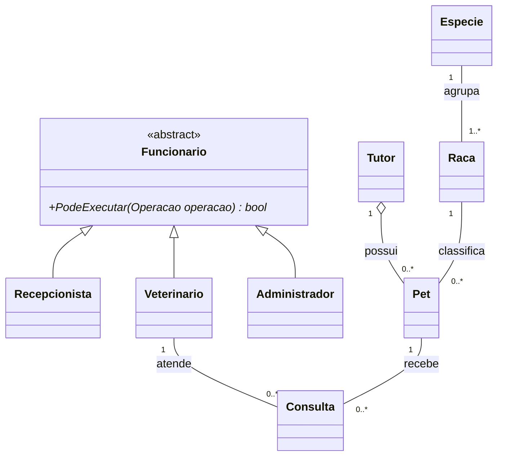

# VetCare — Clínica Veterinária

O VetCare é um portal web criado para organizar o atendimento de clínicas veterinárias:
- **Recepcionista:** cuida dos cadastros de tutores e pets e dos agendamentos;
- **Veterinário:** acompanha a agenda e o histórico e registra o atendimento na consulta;
- **Administração:** gerencia o cadastro de funcionários e pode acessar as funções dos veterinários e dos recepcionistas.

Projeto da P2 de Programação Orientada a Objetos (ILP007), do curso de Análise e Desenvolvimento de Sistemas da FATEC Ribeirão Preto.

**Tecnologias:** C#, .NET 8, ASP.NET Core MVC com Razor, Dapper e SQLite.

## Equipe

| Nome completo | RA |
| --- | --- |
| Alice Abreu Marino | 2840482511031 |
| Daniel Santana da Silva | 2840482511019 |
| Estêvão Pereira de Paula | 2840482511022 |

## Diagrama de classes simplificado

O diagrama mostra os vínculos entre as entidades principais. Cada pet tem um tutor e uma raça. Cada consulta está ligada a um pet e a um veterinário. Espécies e raças compõem os catálogos usados no cadastro.

O projeto não usa login ou senha. Para demonstrar as funções de cada perfil, use o botão "Trocar usuário" no menu superior.
