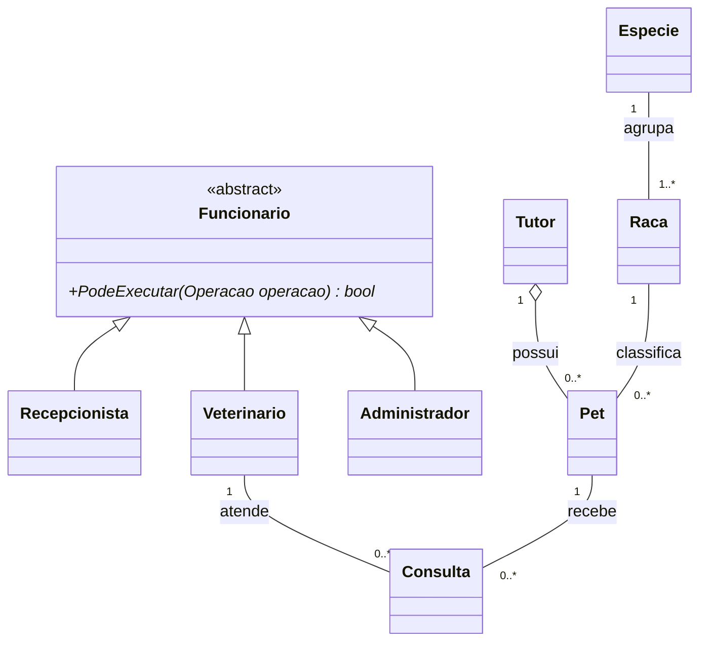

# VetCare — Clínica Veterinária

O VetCare é um portal web criado para organizar o atendimento de clínicas veterinárias:
- **Recepcionista:** cuida dos cadastros de tutores e pets e dos agendamentos;
- **Veterinário:** acompanha a agenda e o histórico e registra o atendimento na consulta;
- **Administração:** gerencia o cadastro de funcionários e pode acessar as funções dos veterinários e dos recepcionistas.

Projeto da P2 de Programação Orientada a Objetos (ILP007), do curso de Análise e Desenvolvimento de Sistemas da FATEC Ribeirão Preto.

**Tecnologias:** C#, .NET 8, ASP.NET Core MVC com Razor, Dapper e SQLite.

## Equipe

| Nome completo | RA |
| --- | --- |
| Alice Abreu Marino | 2840482511031 |
| Daniel Santana da Silva | 2840482511019 |
| Estêvão Pereira de Paula | 2840482511022 |

## Diagrama de classes simplificado

O diagrama mostra os vínculos entre as entidades principais. Cada pet tem um tutor e uma raça. Cada consulta está ligada a um pet e a um veterinário. Espécies e raças compõem os catálogos usados no cadastro.



O projeto não usa login ou senha. Para demonstrar as funções de cada perfil, use o botão "Trocar usuário" no menu superior.

## Como configurar e executar

### 1. Preparar o ambiente

Instale o SDK do .NET 8. Se for baixar pelo Git, execute os comandos abaixo. Se já tiver o projeto, abra o terminal na pasta que contém `VetCare.csproj`.

```powershell
git clone https://github.com/daniel-zip/poo-clinica-vet.git
cd poo-clinica-vet
```

Na pasta do projeto, restaure as dependências.

```powershell
dotnet restore
```

### 2. Configurar a string de conexão

Abra [`appsettings.json`](appsettings.json) e confira a chave `ConnectionStrings:DefaultConnection`. O projeto já vem com esta configuração:

```json
{
  "ConnectionStrings": {
    "DefaultConnection": "Data Source=Database/vetcare.db;Foreign Keys=True"
  }
}
```

`Data Source` indica o arquivo SQLite. Caminhos relativos partem da pasta do projeto. Para usar outro arquivo, altere `Data Source` e escolha um local onde a aplicação possa gravar. Mantenha `Foreign Keys=True` para ativar as chaves estrangeiras.

### 3. Criar e popular o banco

Na primeira execução com um banco novo, a aplicação roda [`Database/script.sql`](Database/script.sql) automaticamente para criar as tabelas e inserir os dados de demonstração.

Se quiser executar o script antes de iniciar a aplicação, instale o utilitário `sqlite3` e rode este comando na raiz do projeto, usando um arquivo de banco novo:

```powershell
sqlite3 -bail "Database/vetcare.db" ".read Database/script.sql"
```

Se alterou `Data Source`, use o mesmo caminho no comando. Para bancos já existentes, deixe a aplicação aplicar as migrações na inicialização. Consulte o [guia do banco de dados](Database/README.md) para mais detalhes.

### 4. Iniciar a aplicação

```powershell
dotnet run
```

Abra `http://localhost:5187` ou o endereço exibido no terminal.
